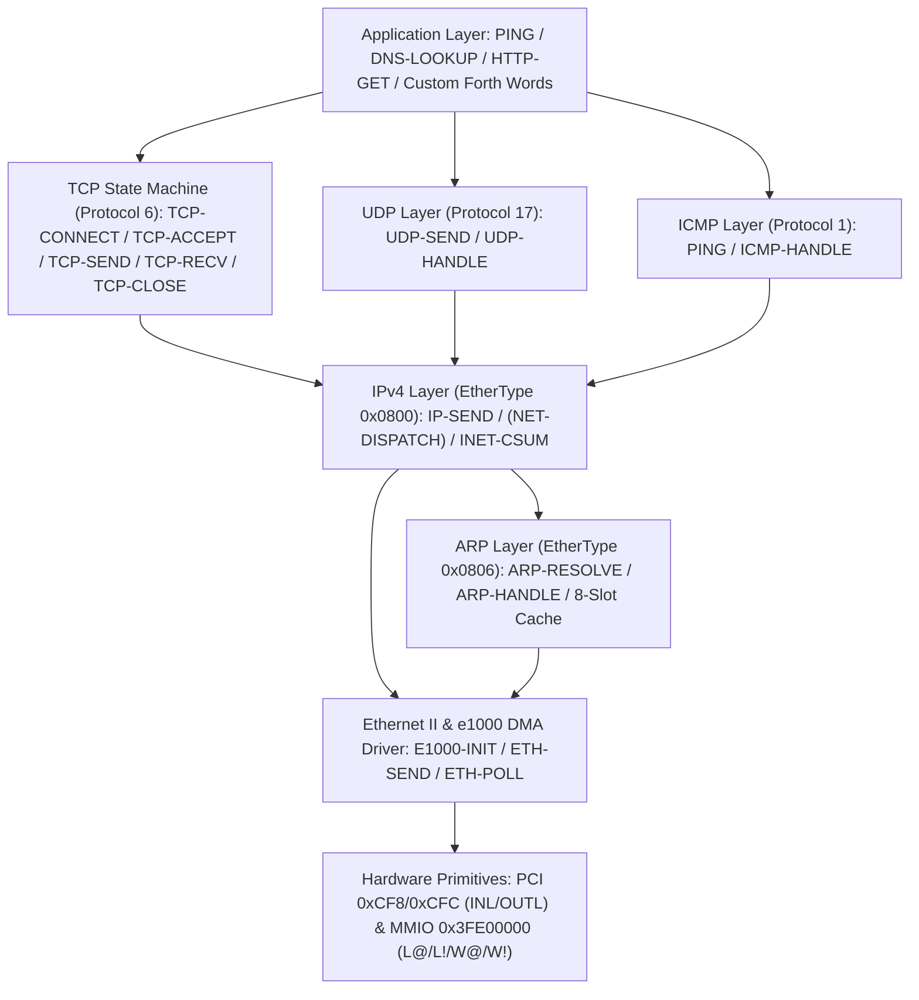
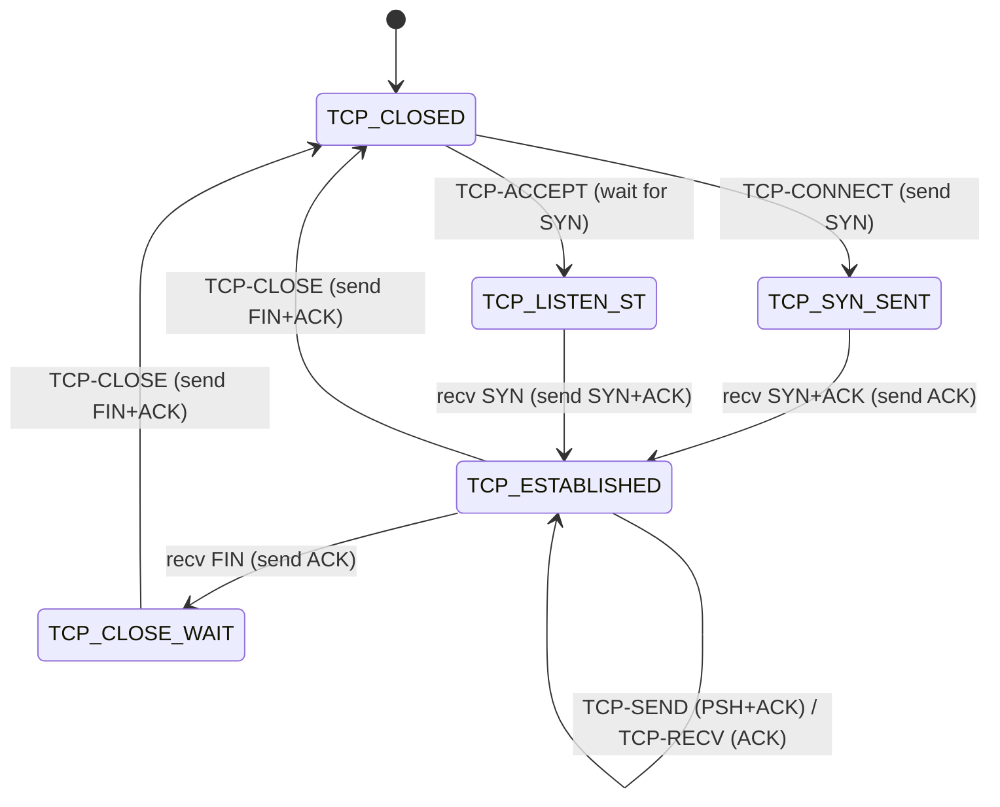

# `net.f` — Forth TCP/IPv4 Stack & Intel `e1000` Driver for f64OS

[disk_files/net.f](file:///home/tliston/Research/bare-metal/f64OS/disk_files/net.f) is a complete, self-contained, `INCLUDE`-able network stack written in f64 Forth. Starting from raw PCI configuration ports and DMA descriptor rings, it implements:

* **PCI Bus Enumeration & Intel 82540EM (`e1000`, `8086:100e`) NIC Driver**
* **Ethernet II Framing & Big-Endian Network Byte-Order Helpers**
* **ARP Cache, Request/Reply, and Subnet/Gateway Routing**
* **IPv4 Packet Assembly, Demultiplexing, and RFC 1071 Checksums**
* **ICMP Echo Request (`PING`) and Automatic Echo Reply**
* **UDP Datagrams, DHCP Client (`DHCP`), & DNS A-Record Resolver (`DNS-LOOKUP`)**
* **TCP Client & Server State Machine (`TCP-CONNECT`, `TCP-ACCEPT`, `TCP-SEND`, `TCP-RECV`, `TCP-CLOSE`)**
* **HTTP/1.0 Client (`HTTP-GET`)**

---

## 1. Quick Start

QEMU and Virtual Machine Manager (`virt-manager`) both run an internal DHCP server on their virtual networks (`10.0.2.0/24` for QEMU user-mode networking, `192.168.122.0/24` for libvirt's `virbr0` NAT bridge).

At the f64OS Forth prompt, load the stack:

```forth
INCLUDE net.f
```

`net.f` discovers and initializes the `e1000` controller on the PCI bus, runs a full 4-way **DHCP** handshake (`DISCOVER` $\to$ `OFFER` $\to$ `REQUEST` $\to$ `ACK`) to dynamically acquire `MY-IP`, `NET-MASK`, `GW-IP`, and `DNS-IP`, and prints the leased configuration:

```text
Acquiring IP via DHCP... OK
f64OS TCP/IP stack ready.
NIC MAC : 52:54:00:12:34:56
Local IP: 10.0.2.15
Netmask : 255.255.255.0
Gateway : 10.0.2.2
DNS Srv : 10.0.2.3
```

Try pinging the QEMU gateway, resolving a domain name, or fetching a web page from your host machine:

```forth
GW-IP PING
S" example.com" DNS-LOOKUP .IP CR
GW-IP 8000 S" /" HTTP-GET
```

When finished, you can unload the entire network stack and reclaim its dictionary memory:

```forth
NET-UNLOAD
```

---

## 2. System Architecture



### 2.1 Supporting Kernel Primitives ([kernel/f64_baremetal.nasm](file:///home/tliston/Research/bare-metal/f64OS/kernel/f64_baremetal.nasm))
While standard f64 Forth provides 64-bit (`@`, `!`) and 8-bit (`C@`, `C!`) memory access alongside 8/16-bit port I/O (`INB`, `OUTB`, `INW`, `OUTW`), PCI Configuration Space and `e1000` MMIO registers require 32-bit operations, and ring descriptors use 16-bit fields. Six native primitives in [kernel/f64_baremetal.nasm](file:///home/tliston/Research/bare-metal/f64OS/kernel/f64_baremetal.nasm#L372-L395) support this:

| Word | Stack Effect | Instruction | Purpose |
| :--- | :--- | :--- | :--- |
| `W@` | `( addr -- u16 )` | `movzx rax, word [rbx]` | 16-bit little-endian memory read |
| `W!` | `( u16 addr -- )` | `mov [rbx], ax` | 16-bit little-endian memory write |
| `L@` | `( addr -- u32 )` | `mov eax, [rbx]` | 32-bit little-endian memory read (zero-extended) |
| `L!` | `( u32 addr -- )` | `mov [rbx], eax` | 32-bit little-endian memory write |
| `INL` | `( port -- u32 )` | `in eax, dx` | 32-bit I/O port read |
| `OUTL` | `( u32 port -- )` | `out dx, eax` | 32-bit I/O port write |

---

### 2.2 PCI Discovery & MMIO Remapping (`E1000-INIT`)
1. **PCI Bus Scan**: `E1000-INIT` scans Bus 0 (`devices 0..31`, function 0) using PCI Configuration Mechanism #1 (`0xCF8` address port, `0xCFC` data port) looking for Vendor ID `0x8086` and Device ID `0x100E` (`0x100E8086` = `269385862`).
2. **Mapping BIOS `BAR0` into the Page Directory (`PD[511]`)**:
   - At boot, SeaBIOS assigns `e1000`'s `BAR0` MMIO region to `0xFEB80000` (~4 GiB, inside the hardware 32-bit PCI MMIO hole).
   - However, [stage2/paging.nasm](file:///home/tliston/Research/bare-metal/f64OS/stage2/paging.nasm) identity-maps only the first **1 GiB** of physical address space (`0x00000000`–`0x3FFFFFFF`). And on VMs configured with $\ge 1\text{ GiB}$ of RAM (such as the default in Virtual Machine Manager), physical address `0x3FE00000` is backed by system RAM rather than the PCI bus.
   - To work with any amount of VM RAM, `E1000-INIT` keeps the BIOS-assigned `BAR0` physical address (`E1000-BAR0`), updates the last 2 MiB Page Directory entry (`PD[511]` at physical address `0x3FF8`, which maps virtual `0x3FE00000`–`0x3FFFFFFF`) to point to `E1000-BAR0`'s 2 MiB physical frame with `PAGE_PRESENT | PAGE_WRITE | PAGE_PWT | PAGE_PCD | PAGE_PS` (`0x9B`), sets `E1000-MMIO` to `0x3FE00000 + (E1000-BAR0 & 0x1FFFFF)`, and writes `0x0007` (I/O Space + Memory Space + Bus Master DMA Enable) to the PCI Command register (`offset 0x04`).
3. **MAC Address & Link Setup**:
   - Masks hardware interrupts (`IMC = 0x00D8`), sets `SLU` (Set Link Up) and `ASDE` in `CTRL` (`0x0000`), and reads the 6-byte hardware MAC address from `RAL0` (`0x5400`) and `RAH0` (`0x5404`) into `MY-MAC`.
4. **DMA Descriptor Rings**:
   - Allocates 16-byte-aligned 8-descriptor RX and TX rings (`RX-RING`, `TX-RING`, 128 bytes each) backed by 2 KiB packet buffers (`RX-BUFS`, `TX-BUFS`, 16 KiB each).
   - Programs `RDBAL`/`RDBAH`/`RDLEN`/`RDH`/`RDT` and enables reception in `RCTL` (`0x0100`).
   - Programs `TDBAL`/`TDBAH`/`TDLEN`/`TDH`/`TDT`/`TIPG` and enables transmission in `TCTL` (`0x0400`).

---

### 2.3 Ethernet II, ARP, and Routing
* **Network Byte Order**: Because x86-64 is little-endian and TCP/IP headers are big-endian, `net.f` provides `BE16@`, `BE16!`, `BE32@`, and `BE32!` to read and write unaligned 16-bit and 32-bit big-endian fields.
* **Routing (`NEXT-HOP-IP`)**: Before transmitting an IPv4 packet to `dst-ip`, `NEXT-HOP-IP` checks `(dst-ip & NET-MASK) == (MY-IP & NET-MASK)`. If the destination is on the local subnet, it resolves `dst-ip` directly; otherwise, it resolves `GW-IP` (`10.0.2.2`).
* **ARP Cache & Protocol (`ARP-RESOLVE`, `ARP-HANDLE`)**:
  - Maintains an 8-entry circular table (`ARP-IPS` and `ARP-MACS`).
  - If the next-hop IP is not cached, `ARP-RESOLVE` broadcasts an Ethernet ARP Request (`opcode 1`) and polls `NET-POLL` until the ARP Reply (`opcode 2`) arrives or times out.
  - `ARP-HANDLE` records sender IP/MAC pairs from incoming ARP traffic and automatically replies to ARP Requests targeting `MY-IP`.

---

### 2.4 IPv4, Checksums, and ICMP
* **RFC 1071 Checksum (`INET-CSUM`)**: `CSUM-PART` accumulates big-endian 16-bit words across a buffer (handling odd byte lengths), and `CSUM-FOLD` folds 32-bit carry bits into 16 bits and takes the one's complement (`65535 XOR`).
* **IPv4 Framing (`IP-SEND`)**: Prepends a 20-byte IPv4 header (`Version=4`, `IHL=5`, `DF=1`, `TTL=64`), computes the header checksum, resolves the destination MAC via `ARP-RESOLVE`, and calls `ETH-SEND`.
* **ICMP (`ICMP-HANDLE`, `PING`)**:
  - Incoming Echo Requests (`type 8`) are automatically echoed back to the sender as Echo Replies (`type 0`) with a recalculated checksum.
  - `PING` sends an Echo Request carrying `"f64OS!!"` with an incrementing sequence number and measures round-trip time using the kernel's PIT tick counter (`KSERVICES + 8`).

---

### 2.5 UDP, DHCP Client (`DHCP`), & DNS Resolver (`DNS-LOOKUP`)
* **`UDP-SEND` / `UDP-HANDLE`**: Sends and receives UDP datagrams (IPv4 protocol `17`), storing the most recent incoming payload in `UDP-RX-DATA` (`UDP-RX-LEN` bytes) and destination port in `UDP-RX-PORT`.
* **`DHCP ( -- flag )` (RFC 2131)**:
  - Broadcasts a `DHCPDISCOVER` (`Option 53 = 1`) from `0.0.0.0:68` to `255.255.255.255:67` (`FF:FF:FF:FF:FF:FF`) requesting Subnet Mask (`Option 1`), Router (`Option 3`), and DNS Server (`Option 6`).
  - Parses the incoming `DHCPOFFER` (`Option 53 = 2`), extracts the offered `yiaddr` and server identifier (`Option 54`), and broadcasts a `DHCPREQUEST` (`Option 53 = 3`).
  - Upon receiving `DHCPACK` (`Option 53 = 5`), sets `MY-IP`, `NET-MASK`, `GW-IP`, and `DNS-IP` automatically (falling back to `10.0.2.15/24` only if no DHCP server responds).
* **`DNS-LOOKUP ( name-addr name-len -- ip32 | 0 )`**:
  - Converts a dotted domain string (e.g. `"example.com"`) into DNS wire-format length-prefixed labels (`\x07example\x03com\x00`) via `DNS-ENCODE-NAME`.
  - Sends a standard recursive `A`-record (`Type 1`, `Class IN`) query to `DNS-IP` (`10.0.2.3`) on UDP port `53`.
  - Parses the response header and answer section (handling both standard labels and `0xC0` compressed label pointers via `DNS-SKIP-NAME`) and returns the resolved 32-bit IPv4 address (or `0` on failure).

---

### 2.6 TCP State Machine & HTTP Client
`net.f` implements a single-connection TCP endpoint supporting both client (`TCP-CONNECT`) and server (`TCP-ACCEPT`) roles:



* **Pseudo-Header Checksum (`TCP-CSUM`)**: Sums `MY-IP`, `TCP-RIP`, protocol `6`, and TCP segment length before summing the 20-byte TCP header and payload.
* **Stream Buffering (`TCP-RX-BUF`)**: Incoming in-order data segments (`SEQ == TCP-RCV-NXT`) are appended to the 4 KiB `TCP-RX-BUF`, `TCP-RCV-NXT` is advanced, and an immediate `ACK` is transmitted. `TCP-RECV` copies up to `maxlen` bytes out of `TCP-RX-BUF` and shifts any remaining unread bytes forward so multi-segment streams are never truncated.

---

## 3. Complete Word Reference

### Network Configuration & Formatting

| Word | Stack Effect | Description |
| :--- | :--- | :--- |
| `IP4` | `( a b c d -- ip32 )` | Pack four decimal octets into a 32-bit IPv4 address (e.g., `10 0 2 15 IP4`) |
| `.IP` | `( ip32 -- )` | Print a 32-bit IPv4 address in dotted-decimal notation |
| `.MAC` | `( addr -- )` | Print a 6-byte MAC address in `XX:XX:XX:XX:XX:XX` hex notation |
| `NET-INFO` | `( -- )` | Display NIC MAC, `MY-IP`, `GW-IP`, and `DNS-IP` |
| `MY-IP` | `( -- ip32 )` | Local IPv4 `VALUE` (default `10.0.2.15`; update with `TO MY-IP`) |
| `GW-IP` | `( -- ip32 )` | Gateway IPv4 `VALUE` (default `10.0.2.2`; update with `TO GW-IP`) |
| `DNS-IP` | `( -- ip32 )` | DNS server IPv4 `VALUE` (default `10.0.2.3`; update with `TO DNS-IP`) |
| `NET-MASK` | `( -- ip32 )` | Subnet mask `VALUE` (default `255.255.255.0`; update with `TO NET-MASK`) |
| `NET-UNLOAD` | `( -- )` | Remove `net.f` words and buffers from the dictionary |

### Low-Level Driver, Ethernet, ARP & IPv4

| Word | Stack Effect | Description |
| :--- | :--- | :--- |
| `E1000-INIT` | `( -- flag )` | Probe PCI bus, map `BAR0`, and initialize `e1000` RX/TX rings |
| `ETH-SEND` | `( addr len -- )` | Transmit raw Ethernet frame (auto-pads to 60 bytes minimum) |
| `ETH-POLL` | `( -- addr len \| 0 )` | Check RX ring for a received frame; returns `addr len` or `0` |
| `NET-POLL` | `( -- )` | Poll `ETH-POLL` and dispatch one incoming ARP/IPv4 packet if present |
| `ARP-RESOLVE` | `( dst-ip -- mac-addr )` | Return 6-byte MAC address for next hop to `dst-ip` |
| `INET-CSUM` | `( addr len -- csum16 )` | Compute 16-bit RFC 1071 one's-complement checksum |
| `IP-SEND` | `( addr len proto dst-ip -- )` | Wrap payload in IPv4 header and transmit over Ethernet |

### ICMP, UDP, DNS, TCP & HTTP

| Word | Stack Effect | Description |
| :--- | :--- | :--- |
| `PING` | `( dst-ip -- )` | Send ICMP Echo Request and print reply time in PIT ticks |
| `DHCP` | `( -- flag )` | Acquire `MY-IP`, `NET-MASK`, `GW-IP`, and `DNS-IP` via DHCP (`TRUE` on lease) |
| `UDP-SEND` | `( addr len sport dport dip -- )` | Send a UDP datagram to `dip:dport` from local port `sport` |
| `DNS-LOOKUP` | `( name-addr name-len -- ip32 \| 0 )` | Resolve hostname to 32-bit IPv4 address via DNS (`0` if not found) |
| `TCP-CONNECT` | `( dst-ip dst-port -- flag )` | Open active TCP connection (`TRUE` when `SYN+ACK` handshake completes) |
| `TCP-ACCEPT` | `( local-port -- flag )` | Listen for incoming TCP connection (`TRUE` on connect, any key aborts) |
| `TCP-SEND` | `( addr len -- )` | Send payload bytes over active TCP connection (`PSH \| ACK`) |
| `TCP-RECV` | `( buf maxlen timeout -- len )` | Read up to `maxlen` bytes within `timeout` ticks (`0` on EOF/timeout) |
| `TCP-CLOSE` | `( -- )` | Send `FIN \| ACK` and close the TCP connection |
| `HTTP-GET` | `( ip port path-addr path-len -- )` | Perform an HTTP/1.0 `GET` request and print the response to the console |

---

## 4. Usage Examples & Recipes

### 4.1 Pinging Hosts and Resolving Domains
```forth
INCLUDE net.f

( Ping the QEMU virtual gateway )
GW-IP PING

( Ping the QEMU virtual DNS server )
10 0 2 3 IP4 PING

( Resolve a domain name and print its IP )
S" example.com" DNS-LOOKUP DUP .IP CR

( Fetch "/" from example.com on port 80 )
80 S" /" HTTP-GET
```

### 4.2 Fetching Files from Your Host Machine via `HTTP-GET`
In QEMU user-mode networking, `GW-IP` (`10.0.2.2`) maps directly to `127.0.0.1` on the host OS.

1. On your host machine, start a local web server in any directory:
   ```bash
   python3 -m http.server 8000
   ```
2. At the f64OS Forth prompt:
   ```forth
   INCLUDE net.f
   GW-IP 8000 S" /" HTTP-GET
   ```

### 4.3 Writing a Custom TCP Client
```forth
256 ALLOT CONSTANT MY-BUF

: TEST-CLIENT ( -- )
    GW-IP 8000 TCP-CONNECT IF
        S" GET / HTTP/1.0" TCP-SEND
        13 MY-BUF C!  10 MY-BUF 1+ C!
        13 MY-BUF 2 + C!  10 MY-BUF 3 + C!
        MY-BUF 4 TCP-SEND

        BEGIN
            MY-BUF 256 100 TCP-RECV
            ?DUP
        WHILE
            MY-BUF SWAP HTTP-PRINT
        REPEAT
        TCP-CLOSE
    THEN
;
```

### 4.4 Running a TCP Server Inside f64OS
To connect from your host machine *into* f64OS, add a host-port forward to your QEMU command (e.g., `-nic user,model=e1000,hostfwd=tcp::8080-:8080`), then run in f64OS:

```forth
256 ALLOT CONSTANT SRV-BUF

: MINI-SERVER ( -- )
    8080 TCP-ACCEPT IF
        SRV-BUF 256 100 TCP-RECV
        ." Received request (" DUP . ." bytes):" CR
        SRV-BUF SWAP HTTP-PRINT CR

        S" HTTP/1.0 200 OK" TCP-SEND
        13 SRV-BUF C!  10 SRV-BUF 1+ C!
        13 SRV-BUF 2 + C!  10 SRV-BUF 3 + C!
        SRV-BUF 4 TCP-SEND
        S" Hello from f64OS Bare-Metal Forth TCP Server!" TCP-SEND
        TCP-CLOSE
    THEN
;

MINI-SERVER
```
Then on your host machine, run `curl http://localhost:8080/`!

